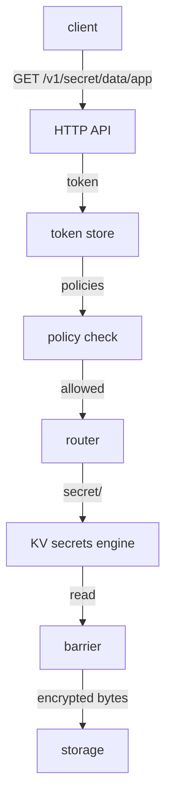

# What OpenBao Is And How A Request Travels

Applications need secrets: a database password, an API key, a TLS certificate. When those secrets live in configuration files and environment variables, they spread to many places, nobody knows who read them, and changing one means changing every copy. This part introduces OpenBao, the server that keeps secrets in one place, and follows one request through it, so you know which part does what before you operate it.

## What OpenBao is

OpenBao is an open-source server that stores secrets encrypted and controls who may read them. A client, such as an application or a person with the `bao` command-line tool, sends a request over HTTP. OpenBao checks the client's token, checks what the token's policies allow, and only then reads or writes the secret.

OpenBao is a fork of HashiCorp Vault 1.14. A fork is a copy of a project's source code that continues as a separate project. When HashiCorp changed Vault's license in 2023, the community started OpenBao to keep an open-source version. It is now a project of LF Projects, under the Linux Foundation, and a sandbox project of the Open Source Security Foundation (OpenSSF). Because of that history, many OpenBao commands and API paths look like Vault's; the command is `bao`, and environment variables start with `BAO_`.

OpenBao does more than store fixed values. Its secrets engines can create credentials on demand, issue certificates and encrypt data for applications. Its auth methods let people and machines sign in with what they already have, such as a Kubernetes service account. This course stays with the foundation all of that needs: a server that runs, protects its data and can be operated from the command line.

## The parts of the server

One OpenBao process contains several parts that work together. It helps to know their names, because logs and documentation use them:

| Part | What it does |
| --- | --- |
| HTTP API | Receives every request on the listener, for example `http://openbao.localtest.me:8200/v1/...` |
| Token store | Checks that the token on a request exists and has not expired |
| Policy check | Decides whether the token's policies allow the operation on the path |
| Router | Sends the request to the mount that owns the path, such as `secret/` |
| Secrets engines and auth methods | Do the work: store a value, create a credential, sign a user in |
| Barrier | Encrypts everything on the way to storage and decrypts it on the way back |
| Storage backend | Keeps the encrypted data, here Integrated Storage, also called Raft |

The diagram follows one request that reads a secret:



The diagram shows that the secrets engine never touches storage directly: every read and write passes through the barrier, which decrypts and encrypts the data.

## The first look at your server

Your playground server is initialized and sealed. Start with the command every operator runs first: `bao status`. It asks the server for its seal status and needs no token.

<!-- astrona:playground:renew -->

```sh
export BAO_ADDR=http://openbao.localtest.me:8200
bao status
```

The output is a table. `Initialized` is `true`, `Sealed` is `true`, `Total Shares` is `5` and `Threshold` is `3`. `Storage Type` is `raft`, and `Version` is `2.7.1`. The command exits with code `2`, which is how `bao status` says "sealed"; code `0` means unsealed and `1` means an error.

Now try to read a secret. The playground already holds one at `secret/inventory/db`:

```sh
bao kv get secret/inventory/db
```

The command fails, and the error says that OpenBao is sealed. You did not even need a token to find that out: a sealed server refuses almost every request before it looks at tokens or policies.

You now know what OpenBao is, which parts handle a request, and that a sealed server refuses to read data. The open question is why a server would be sealed at all, and what it needs to become unsealed. That is about the keys that protect the barrier.

## Common pitfalls

> [!WARNING]
> - **Forgetting `BAO_ADDR`.** Without it, `bao` tries `https://127.0.0.1:8200` and fails with a connection error that has nothing to do with the server. Set `BAO_ADDR` in every new terminal.
> - **Reading exit code 2 as a failure.** `bao status` exits with `2` when the server is sealed. A script that treats every non-zero code as "server down" misreads a sealed server.
> - **Assuming every Vault feature exists.** OpenBao started from Vault 1.14, and the two projects have moved apart since. Check the OpenBao documentation before you rely on a feature.
