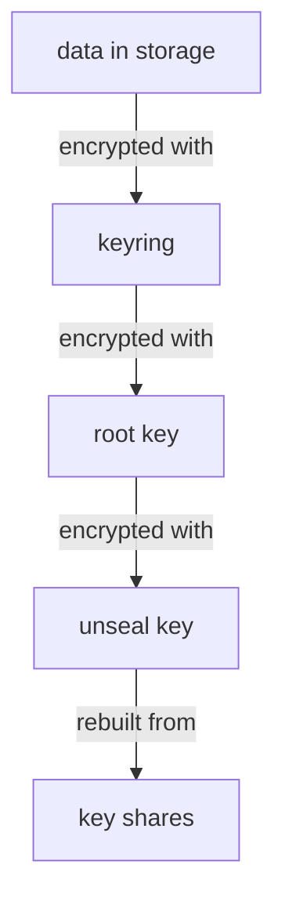

# The Barrier, The Root Key And Shamir's Secret Sharing

A sealed server has its data on disk, yet it cannot read it. To understand why, you need to know which key encrypts the data, which key protects that key, and where the last key comes from. This part opens those layers one by one, then shows how OpenBao splits the last key so that no single person holds it.

## Three layers of keys

OpenBao never encrypts data with a key that sits next to the data in clear text. It uses layers, and each layer protects the one below it:

1. The **barrier** encrypts every value OpenBao writes to storage. It uses the **encryption keys** in the **keyring**.
2. The keyring itself is stored encrypted with the **root key**.
3. The root key is stored encrypted with the **unseal key**.

Only the unseal key is not stored anywhere by OpenBao. With the default seal, people hold it, in pieces. The diagram shows the chain from storage back to the people who hold the pieces:



The diagram shows that the data can only be read after the unseal key is rebuilt from its shares, which decrypts the root key, which decrypts the keyring.

Why not one key? Layers let OpenBao change one key without touching the others. Rotating the encryption key adds a new key to the keyring and needs no new unseal keys. Rotating the unseal keys re-encrypts only the root key and leaves all data as it is. Both operations run while the server is unsealed and serving requests.

## Sealed and unsealed

When OpenBao starts, it is **sealed**. It knows where its storage is, but it holds no key in memory, so it cannot decrypt anything. **Unsealing** means giving OpenBao enough to rebuild the unseal key; OpenBao then decrypts the root key and the keyring and keeps them in memory only.

An unsealed server stays unsealed until one of three things happens: an operator seals it, the process restarts, or the storage layer has an error it cannot recover from. In Kubernetes, that means every restart of the pod seals OpenBao again. Sealing on purpose is a safety action: if you suspect an attack, `bao operator seal` throws the keys out of memory at once, and nobody can read data until the server is unsealed again.

## Shamir's secret sharing

If one person held the unseal key, that person could read every secret, and losing that person's copy would lose all data. OpenBao avoids both with **Shamir's secret sharing**. This method splits a key into several **key shares** and sets a **threshold**: any group of shares at least as large as the threshold rebuilds the key, and a smaller group reveals nothing about it.

Your playground server was initialized with five shares and a threshold of three. Any three of the five shares unseal it, in any order. Two shares are not enough, and they do not even make the key easier to guess. In a real company, five different people hold one share each, so three of them must agree before the server can be unsealed.

You can see the shares the lab keeps in the Secret `openbao-shares`. List the keys of the Secret without printing the values:

<!-- astrona:playground:renew -->

```sh
kubectl -n openbao get secret openbao-shares -o jsonpath='{.data}' | tr ',' '\n' | cut -d'"' -f2
```

The command prints five names, `share-1` to `share-5`. Each value is a share encoded in Base64, a way to write binary data as text. Again: keeping all shares in one Secret, next to the server, defeats the whole purpose of splitting them. The lab does it only so that you and the grader can reach them.

## Auto-unseal in one paragraph

Entering shares by hand after every restart is slow, and it does not fit automated platforms. OpenBao therefore also supports **auto-unseal**: the unseal key is protected by an outside service, such as a cloud key management service (KMS), another OpenBao server's Transit engine, or a hardware security module. At start, OpenBao asks that service to decrypt the root key and unseals itself. With auto-unseal, initialization returns **recovery keys** instead of unseal keys; they authorize sensitive operations but cannot unseal the server. This course uses the default Shamir seal throughout.

You now know which key protects which, why the unseal key is split, and what a threshold means. The open question is how to see, from outside, which state a server is in, and how to enter the shares.

## Common pitfalls

> [!WARNING]
> - **Thinking the root key is the root token.** The root key is an encryption key inside OpenBao. The root token is a credential for API requests. They are unrelated.
> - **Storing all key shares together.** One place that holds a threshold of shares holds the unseal key. Give each share to a different person.
> - **Expecting a restart to keep OpenBao unsealed.** With the Shamir seal, every restart, including a pod restart in Kubernetes, seals the server.
