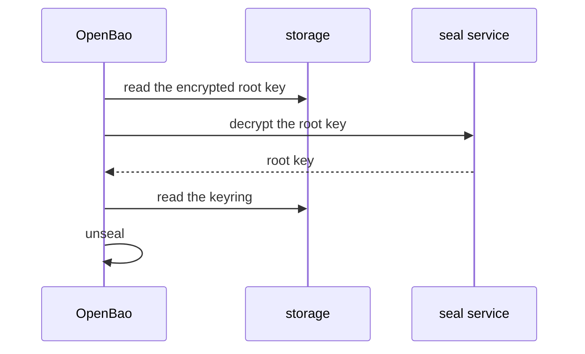

# Seal Types And Auto-Unseal

With the default seal, a person must enter key shares every time the server starts. In a Kubernetes cluster, pods restart for many reasons, and each restart seals OpenBao again. This part shows the other seal types, how they differ from the Shamir seal, and where the choice is written in the configuration.

## What a seal is

A **seal** is the mechanism that protects the root key and gives it back to OpenBao when the server starts. The root key encrypts the keyring, and the keyring encrypts the stored data. The seal decides what must happen before OpenBao can decrypt the root key.

With the **Shamir seal**, the protection is the unseal key, which is split into shares. A group of people must enter a threshold of shares. With an **auto-unseal seal**, the protection is a key held by an outside system. OpenBao sends the encrypted root key to that system at start, receives it decrypted, and unseals itself. Nobody enters anything.

Check which seal your playground server uses:

<!-- astrona:playground:renew -->

```sh
bao status
curl -s $BAO_ADDR/v1/sys/seal-status
```

`bao status` shows `Seal Type` `shamir`. In the JSON, the field `type` is `shamir` and `recovery_seal` is `false`. After this part you will know what changes in both when another seal is used.

## The seal block

The seal is chosen in the configuration file with a `seal` block. A file without a `seal` block uses the Shamir seal, which is why the server in your playground has none. OpenBao supports these seals besides Shamir:

| Seal | Where the outside key lives |
| --- | --- |
| `transit` | The Transit secrets engine of another OpenBao server |
| `static` | A key written in the configuration file or read from a file |
| `pkcs11` | A hardware security module (HSM) reached through the PKCS#11 interface |
| `awskms`, `gcpckms`, `azurekeyvault`, `ocikms` | The key management service of a cloud provider |

A Transit seal block looks like this. It is an example to read; the playground has no second server to point at:

```hcl
seal "transit" {
  address    = "https://central-openbao.example.com:8200"
  key_name   = "autounseal"
  mount_path = "transit/"
}
```

The block says which server to call, which Transit key to use, and where the Transit engine is mounted. The token that the seal uses to call the central server is a separate secret. It needs permission to encrypt and decrypt with that one key only, and it can come from the configuration or from an environment variable. Keep it out of the file when you can.

A seal block takes effect at start, like every other setting. Changing it on a running server needs a restart and, for a server that already holds data, a migration (covered in the next part).

## How auto-unseal changes the start

The diagram shows what happens when a server with an auto-unseal seal starts:



The diagram shows that the unseal key is replaced by a call to the seal service, and that the keyring and the data are read exactly as before.

Two facts follow. First, the seal service must be reachable every time OpenBao starts. If it is down, or if the key was deleted there, the server stays sealed and logs the error. A deleted key means the data cannot be decrypted by anyone. Second, auto-unseal removes the human step at start, but it does not remove the human step of protecting the key. The administrators of the seal service now hold the power that the share holders held before.

## Choosing a seal

The choice is a trade-off between availability and who holds the keys:

- Shamir needs no outside system and keeps control with the share holders, but every restart needs people.
- A cloud key management service or an HSM unseals without people and gives the key its own audit trail, but ties the server to that service.
- Transit lets one central OpenBao server unseal many others, but then the central server must always be available and is a high-value target.
- The static seal needs the least setup, but the key sits in or next to the configuration, so it protects less than the others.

You can now read a `seal` block and say what it changes. One question is still open: if nobody holds unseal shares, what does the initialization give to the operators instead?

## Common pitfalls

> [!WARNING]
> - **Thinking auto-unseal removes the unseal key from the design.** The key is still there. It is held by the seal service instead of by people.
> - **Deleting or disabling the key in the seal service.** OpenBao can no longer start, and the data is lost.
> - **Putting the seal token in a public repository with the configuration.** Anyone with that token can use the seal key.
