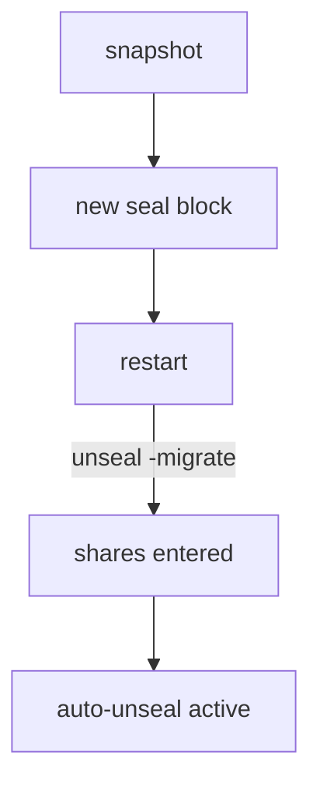

# Recovery Keys And Seal Migration

A server that unseals itself no longer needs key shares to start. Some operations, however, should still need several people to agree: creating a new root token, or changing the key that protects the server. This part explains the recovery keys that cover this, and then shows how a running server changes from one seal to another.

## Recovery keys

When you initialize a server that has an auto-unseal seal, `bao operator init` does not create unseal key shares. It creates **recovery keys** instead. They are produced with the same Shamir method, so there are shares and a threshold, and the options are named `-recovery-shares` and `-recovery-threshold`. You can see the options in the command help:

<!-- astrona:playground:renew -->

```sh
bao operator init -h
```

Look for the three options `-recovery-shares`, `-recovery-threshold` and `-recovery-pgp-keys`. They only apply to a server that has an auto-unseal seal. A Shamir server uses the unseal options instead.

A recovery key cannot unseal the server, because the seal service already does that. It authorizes the operations that must not depend on one person:

- Generating a new root token with `bao operator generate-root`.
- Rotating the recovery keys themselves, with `bao operator rotate-keys -target=recovery`.

Because of this, the seal state of an auto-unseal server shows a second seal type. In `bao status` the line `Recovery Seal Type` appears, and in the JSON of `sys/seal-status` the field `recovery_seal` is `true`. A Shamir server shows `false`, which is the value you saw in the previous part.

## Handling recovery keys

Treat recovery keys like unseal key shares. Give each share to a different person, encrypt the output of `init` with `-recovery-pgp-keys` if you can, and never store a threshold of shares together. Losing them does not stop the server from starting. It does mean nobody can create a new root token if the last one was revoked, which is the same loss of control that a lost threshold of unseal keys causes on a Shamir server.

## Moving to another seal

A server that already holds data can change its seal. This is called **seal migration**. The data does not change. Only the protection of the root key changes. The usual order, for a move from Shamir to an auto-unseal seal, is:

1. Take a Raft snapshot, so a failed attempt can be undone.
2. Add the new `seal` block to the configuration. The server keeps the Shamir seal as the previous seal.
3. Restart the server. It starts sealed and reports that a migration is pending.
4. Run `bao operator unseal -migrate` and enter the existing unseal key shares, up to the threshold.
5. The server re-protects the root key with the new seal and unseals. The old unseal shares now act as recovery keys.

Migration back to Shamir follows the same steps in the other direction: the auto-unseal block gets the setting `disabled = "true"`, and the recovery keys are entered with `-migrate`. In a cluster of several servers, you migrate the active server first and then restart each standby server with the new configuration.

The diagram shows the order for a move from Shamir to auto-unseal:



The diagram shows that the snapshot comes first and that the existing shares are used one last time.

## What stays the same

After a migration, nothing readable changes for clients. The tokens, policies, secrets and mounts are the same, and the root key is the same key. Only the key that encrypts it is new. This is also why a seal migration needs no downtime beyond the restart.

Two checks confirm the result. `bao status` shows the new `Seal Type`, and a restart of the pod brings the server back unsealed without any input. You now know how a server leaves the manual unseal, and what its recovery keys do. A second question remains: how do several servers share the same data, so that one failing server does not stop service?

## Common pitfalls

> [!WARNING]
> - **Expecting recovery keys to unseal the server.** They cannot. They authorize sensitive operations only.
> - **Migrating without a snapshot.** A failed migration then has no way back.
> - **Forgetting that the old shares become recovery keys.** Keep them safe after the migration; they are not waste.
