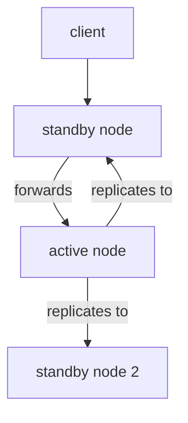

# Raft Cluster And High Availability

One OpenBao server is a single point of failure. If its pod or its node stops, no application can read a secret until the server is back. This part shows how several OpenBao servers work as one cluster, who answers requests, and how you read and change that state.

## Integrated Storage and the Raft protocol

The storage in this course is **Integrated Storage**, which keeps the data in a local database and replicates it with the **Raft** consensus protocol. Raft makes the servers of a cluster agree on one ordered list of changes. A change counts as written only when a majority of the servers have stored it.

Each server in the cluster is a **node**. It has a `node_id` in its `storage "raft"` block, a path for its data, and the addresses `api_addr` (for clients) and `cluster_addr` (for the other nodes). A node joins a cluster either with a `retry_join` block in its configuration:

```hcl
storage "raft" {
  path    = "/openbao/data"
  node_id = "openbao-1"

  retry_join {
    leader_api_addr = "http://openbao-0.openbao-internal:8200"
  }
}
```

or by hand with `bao operator raft join http://openbao-0.openbao-internal:8200`. The Helm chart builds clusters of this kind when you set `server.ha.enabled` and `server.ha.raft.enabled` to `true` and give `server.ha.replicas` the number of nodes. The playground uses the standalone mode with one node.

## Active and standby

Only one node serves requests at a time. The **active** node is the Raft leader. The other nodes are **standby** nodes: they hold the same data, and they stay unsealed, but they do not serve requests themselves. When a client reaches a standby node, that node forwards the request to the active node over the cluster port. This is called request forwarding. If forwarding is not possible, the standby node answers with a redirect to the address of the active node, and the client must follow it.

If the active node fails, the remaining nodes hold an election and one standby node becomes the new active node. A load balancer should send traffic to any node and let OpenBao forward it, or use the health endpoint to find the active node: it answers `200` on the active node and `429` on a standby node.



The diagram shows that clients may reach any node and that the active node replicates every write to the standby nodes.

## Quorum and the number of nodes

Raft needs a majority, called a **quorum**, to elect a leader and to commit a write. A cluster of three nodes has a quorum of two, so it survives the loss of one node. A cluster of five has a quorum of three and survives two failures. Four nodes also need three, so they tolerate one failure, the same as three nodes; an even number of nodes adds cost and no safety. Use three or five.

If a cluster loses its quorum, it stops serving requests, and it does not lose data. It continues when enough nodes return. Nodes that are gone for good must be removed, with `bao operator raft remove-peer <node_id>`, or the cluster keeps counting them.

## Reading the cluster

Three commands show the state. Sign in with the root token first (`bao login`), then run them:

<!-- astrona:playground:renew -->

```sh
bao operator raft list-peers
bao status
curl -s $BAO_ADDR/v1/sys/leader
```

`list-peers` prints one line per node with its `Node` name, its `Address`, its `State` (`leader` or `follower`) and whether it is a `Voter`. On the playground it has one line, `openbao-0`, with the state `leader`. `bao status` shows `HA Enabled` `true`, `HA Mode` `active` and the `Active Node Address`. The `sys/leader` endpoint answers the same questions as JSON and needs no token.

## Handing over the active role

An operator can ask the active node to give up its role, for example before maintenance on that node:

```sh
bao operator step-down
```

On a cluster, a standby node takes over within seconds and clients are redirected. The old active node becomes a standby node. In the one-node playground there is no standby node, so the same node wins the election again and stays active; the command succeeds and changes nothing you can see, except a short pause.

You can now read a cluster and explain what happens when its active node fails. The next question is about the data itself: a cluster protects against a failing node, but it replicates a mistake or a deletion to every node. Only a copy taken at a known moment protects against that.

## Common pitfalls

> [!WARNING]
> - **Running two nodes.** Two nodes have a quorum of two, so losing either one stops the cluster.
> - **Pointing every client at one pod.** Use the Service or a load balancer and let OpenBao forward requests.
> - **Treating replication as a backup.** A deleted secret is deleted on every node at once.
