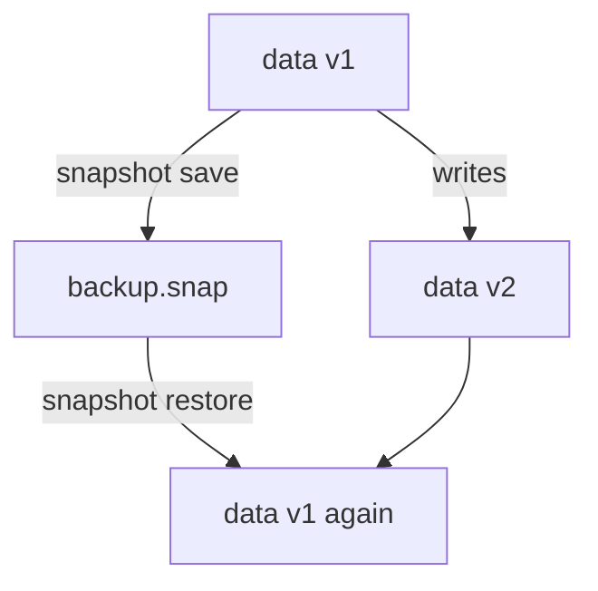

# Raft Snapshots

A cluster keeps the service running when a node fails, but it copies every change to every node, including a mistake. A wrong deletion, a bad migration or a corrupted storage volume exists on all nodes within seconds. A **snapshot** is a point-in-time copy of the whole data set that you keep outside the cluster. This part saves one, changes the data, and restores the copy.

## What a snapshot contains

A Raft snapshot holds everything in Integrated Storage at one moment: secrets, policies, mounts, auth methods, tokens, leases and the encrypted keyring. The values inside are still encrypted by the barrier. A snapshot file is therefore as sensitive as the storage itself, and it is only useful together with the unseal keys that match it.

That last point matters after key rotation. A snapshot also holds the root key as it was encrypted at that moment. If you rotated the unseal keys after the snapshot and restore it, the server expects the unseal keys of the snapshot time. Keep old unseal keys until no snapshot needs them.

## Saving a snapshot

The command asks the active node for a snapshot and writes it to a file on the machine where you run the command. It needs a token with the `read` capability on `sys/storage/raft/snapshot`. First sign in with the lab's root token, and give the server a secret worth saving. The playground server starts without a KV engine, so enable one:

<!-- astrona:playground:renew -->

```sh
export BAO_TOKEN="$(kubectl -n openbao get secret openbao-init -o jsonpath='{.data.root-token}' | base64 -d)"
bao secrets enable -path=secret kv-v2
bao kv put secret/inventory/db username=inventory password=original-password
```

Now save the snapshot and check the file:

```sh
bao operator raft snapshot save backup.snap
ls -l backup.snap
```

The file exists and has a size above zero. Taking a snapshot does not stop the server and does not block clients, so you can run it on a schedule. In Kubernetes, a CronJob with a service account token or an AppRole is the usual way; the job then copies the file to storage outside the cluster.

## Changing the data after the snapshot

To see a restore work, change something. Write a secret that did not exist when the snapshot was taken, and a second version of an existing secret:

```sh
bao kv put secret/inventory/extra note=written-after-the-snapshot
bao kv put secret/inventory/db username=inventory password=changed-after-the-snapshot
bao kv metadata get secret/inventory/db
```

The metadata of `secret/inventory/db` now shows the current version as `2`, because the second write created a new version.

## Restoring a snapshot

Restoring replaces all the data of the cluster with the content of the file. Everything written after the snapshot is lost, which is the point:

```sh
bao operator raft snapshot restore backup.snap
bao kv get secret/inventory/db
bao kv get secret/inventory/extra
```

The first read shows the original password and the current version `1`. The second read fails, because `secret/inventory/extra` did not exist in the snapshot. The restore went through the whole data set at once, and no version history of a secret is needed to undo it.

If you restore a snapshot from a different cluster, which has different unseal keys, the command refuses unless you add `-force`, and you must unseal the server with the unseal keys of the snapshot. This is how a cluster is rebuilt on new infrastructure.

The diagram shows the order in the test above:



The diagram shows that a restore returns the cluster to the state of the file, no matter what was written after.

## What a snapshot does not replace

A snapshot protects the stored data. It does not contain the configuration file, the Helm values, TLS certificates or the unseal keys. Keep those under separate control. A good plan has three parts: the snapshot schedule, the place where the files are copied, and a restore that you have practiced.

You can now save and restore the data of a server. The graded lab asks you to restore a server that holds a secret you must not lose.

## Common pitfalls

> [!WARNING]
> - **Keeping the snapshot only on the pod.** A snapshot saved inside a pod is lost with the pod. Copy it out.
> - **Keeping the snapshot next to the unseal keys.** Together they open the data. Store them separately.
> - **Never testing a restore.** A backup that was never restored is a guess.

## Your mission: Restore OpenBao From A Raft Snapshot

You can now save a snapshot, change data, and restore the earlier state. The graded lab gives you a server where a bad change was made after a snapshot was taken. The snapshot is stored in the Kubernetes Secret `pre-change-snapshot`. You must get the file out of the Secret and restore the server from it, without initializing a new server.

The lab runs in its own cluster, so first pause your playground. Nothing in it is lost:

```sh
astrona stop ats-112-playground-010-02
```

Then start the lab:

```sh
astrona run --git ssh://git@github.com/astrona-io/ATS112.git -c sections/section-010/module-02/labs/lab-01
```

The task is on the next page. Solve it on your own first. When you think you are done, send it for grading:

```sh
astrona submit -c sections/section-010/module-02/labs/lab-01
```

When the lab is done, remove it and start your playground again:

```sh
astrona destroy ats-112-lab-010-02
astrona start ats-112-playground-010-02
```
