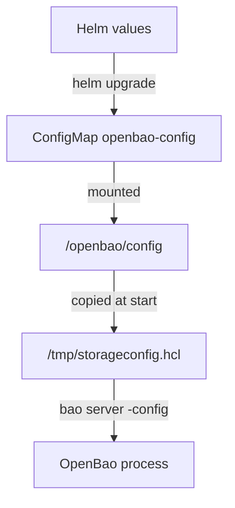

# How The Helm Chart Runs The Server

On Kubernetes you rarely edit the configuration file itself. You edit Helm values, and the chart turns them into the file. To change a running server safely, you need to know each step of that path, including the step people forget: the restart.

## From values to a running process

The chart reads the configuration from the value `server.standalone.config`, a multi-line string with the HCL. It writes that string into the ConfigMap `openbao-config`, under the key `extraconfig-from-values.hcl`, and mounts the ConfigMap at `/openbao/config`. When the container starts, its start command copies the file to `/tmp/storageconfig.hcl`, replaces a few placeholder words, and runs `bao server -config=/tmp/storageconfig.hcl`.



The diagram shows that the process only reads the file when it starts; nothing in the path pushes a change into a running server.

The placeholders let one configuration fit every pod. The start command replaces the words `HOSTNAME`, `POD_IP`, `HOST_IP` and `API_ADDR` in the file with real values, so a cluster configuration can write `node_id = "HOSTNAME"`. The chart also sets environment variables on the container: `BAO_ADDR=http://127.0.0.1:8200`, so `bao` inside the pod talks to the local server, and `BAO_API_ADDR` and `BAO_CLUSTER_ADDR` with addresses based on the pod.

Read the values of your playground's release to see the starting point of every change:

<!-- astrona:playground:renew -->

```sh
helm get values openbao -n openbao
```

The output shows `server.standalone.config` with the configuration you read before, the image tag `2.7.1` and the data storage size `1Gi`.

## The restart nobody does

The chart's StatefulSet uses the update strategy `OnDelete`. With that strategy, Kubernetes does not replace pods when the StatefulSet changes; it waits until you delete a pod. The ConfigMap does change at once, but the running process does not read it again. Check the strategy:

```sh
kubectl -n openbao get statefulset openbao -o jsonpath='{.spec.updateStrategy.type}{"\n"}'
```

It prints `OnDelete`. So every configuration change is three steps: `helm upgrade` with the new values, `kubectl delete pod openbao-0`, and unsealing the new pod, because a restart seals OpenBao.

Try a harmless change: raise the log level to `debug`. Save this as `openbao-values-debug.yaml`:

```yaml
fullnameOverride: openbao
injector:
  enabled: false
server:
  image:
    tag: "2.7.1"
  standalone:
    enabled: true
    config: |
      ui        = true
      log_level = "debug"

      listener "tcp" {
        tls_disable     = 1
        address         = "[::]:8200"
        cluster_address = "[::]:8201"
      }

      storage "raft" {
        path    = "/openbao/data"
        node_id = "openbao-0"
      }

      api_addr     = "http://openbao.localtest.me:8200"
      cluster_addr = "http://openbao-0.openbao-internal:8201"
  dataStorage:
    enabled: true
    size: 1Gi
ui:
  enabled: true
```

Apply it, restart the pod and unseal it with the lab's key:

```sh
helm upgrade openbao openbao/openbao --version 0.30.4 -n openbao -f openbao-values-debug.yaml
kubectl -n openbao delete pod openbao-0
bao operator unseal "$(kubectl -n openbao get secret openbao-init -o jsonpath='{.data.unseal-key}' | base64 -d)"
```

The unseal command can fail for a few seconds while the new pod starts; run it again until it reports `Sealed` `false`. Then `kubectl -n openbao logs openbao-0` shows many more lines than before: the new log level is active.

You now know where the configuration file of a pod comes from and the three steps that make a change count. The open question is the other way to run OpenBao, the one that needs no configuration file at all.

## Common pitfalls

> [!WARNING]
> - **Running `helm upgrade` and expecting the change to be live.** With `OnDelete`, delete the pod, then unseal it.
> - **Editing the ConfigMap with `kubectl edit`.** The next `helm upgrade` overwrites it. Change the Helm values instead.
> - **Leaving out `--version` on `helm upgrade`.** Without it, Helm may upgrade the chart itself at the same time as your configuration.

## Your mission: Repair A Server Configuration

You can now read a configuration, change it through Helm and make the change count. The graded lab gives you a server that is not Ready after a colleague changed its configuration, and asks you to make it serve its original data again.

The lab runs in its own cluster, so first pause your playground. Nothing in it is lost:

```sh
astrona stop ats-112-playground-020-01
```

Then start the lab:

```sh
astrona run --git ssh://git@github.com/astrona-io/ATS112.git -c sections/section-020/module-01/labs/lab-01
```

The task is on the next page. Solve it on your own first. When you think you are done, send it for grading:

```sh
astrona submit -c sections/section-020/module-01/labs/lab-01
```

When the lab is done, remove it and start your playground again:

```sh
astrona destroy ats-112-lab-020-01
astrona start ats-112-playground-020-01
```
