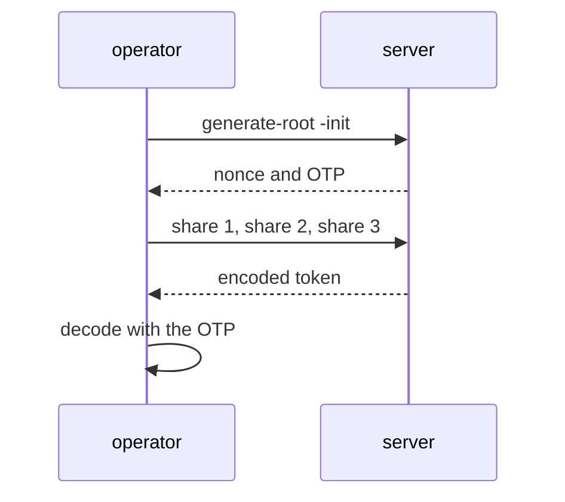

# Generating A New Root Token

After the root token is revoked, nobody can do everything any more, and that is the goal. Some day an administrator account will be locked, a policy will be wrong, or an authentication method will be misconfigured so that nobody can sign in. The key holders must then be able to create a root token again, without the server's data being touched. This part shows how, and why it needs several people.

## Why generate-root exists

A root token cannot be recovered. OpenBao does not store it in a form that it can show again. The command `bao operator generate-root` creates a new root token, but only when a threshold of the key holders take part. On a Shamir server these are the holders of the unseal key shares. On a server with an auto-unseal seal they are the holders of the recovery keys. No single person can create a root token alone.

The process runs on the server as an operation with a number of steps. A **nonce** is the identifier of the running operation: every key holder must send the same nonce, so that shares from two different operations do not mix. A **one-time password** (OTP) protects the result: the server encrypts the new root token with it, and only someone with the OTP can read it.

## The steps

Signing in is not needed for these commands, because the key shares are the credential. The playground server is unsealed; if you did not initialize it with five shares and a threshold of three, run `bao operator init -key-shares=5 -key-threshold=3 -format=json > init.json` first and unseal the server.

Start the operation:

<!-- astrona:playground:renew -->

```sh
bao operator generate-root -init
```

The output shows `Nonce`, `Started` `true`, the `Progress` as `0/3`, `Complete` `false`, and an `OTP` with its length. Save the nonce and the OTP in shell variables, because the next commands and the final decode need them:

```sh
export NONCE="<nonce from the output>"
export OTP="<otp from the output>"
```

Now each key holder enters their share. In a real company this happens on three different machines, at different times if needed. Here you enter three shares from `init.json`:

```sh
bao operator generate-root -nonce="$NONCE" "$(jq -r '.unseal_keys_b64[0]' init.json)"
bao operator generate-root -nonce="$NONCE" "$(jq -r '.unseal_keys_b64[1]' init.json)"
bao operator generate-root -nonce="$NONCE" "$(jq -r '.unseal_keys_b64[2]' init.json)"
```

Each call shows the progress, `1/3`, `2/3`, and then `Complete` `true` with an `Encoded Token`. The encoded token is not usable yet. It is the new root token encrypted with the OTP.

Decode it with the OTP:

```sh
bao operator generate-root -decode="<encoded token from the output>" -otp="$OTP"
```

The command prints the new root token. Use it with `bao login` or `BAO_TOKEN`, do what you came to do, and revoke it.

The diagram shows the order of the operation:



The diagram shows that the server never sends the new root token in the clear: it sends it encrypted with the OTP.

## Checking and cancelling

While an operation runs, `bao operator generate-root -status` shows the nonce and the progress. `bao operator generate-root -cancel` stops it, which is the right move when someone entered a wrong share or when you are not sure who started it. Only one operation can run at a time on a server. Cancelling is also how you notice an unwanted attempt: if the status shows an operation nobody started, treat it as an incident.

## Handling the new token

A root token made with this command is as powerful as the first one, and it never expires. Do the single task that needed it. Then run `bao token revoke -self` with the new token. A good habit is to write down who took part, when, and why. The audit log records the operation, and a record kept by the team explains it.

You can now recover root access without touching data, and you know that it needs a threshold of key holders. Together with initializing, unsealing, sealing and rotating, this finishes the operator's toolkit for the keys of a server.

## Common pitfalls

> [!WARNING]
> - **Losing the OTP before decoding.** The encoded token is then unreadable, and you must cancel and start again.
> - **Mixing nonces.** Shares sent with an old nonce are rejected.
> - **Leaving the new root token in use.** Revoke it as soon as the task is done.
